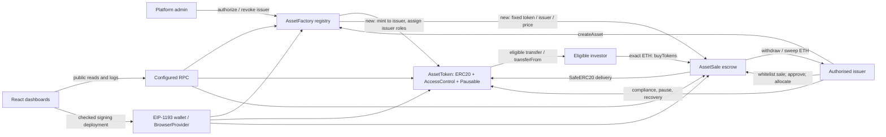

# SC4053 AI Audit Report

**Tokenisation of Real-World and Digital Assets on Ethereum**  
NTU SC4053, AY2026–2027 Semester 1. Evidence cut-off: 6 November 2026 (Asia/Singapore). Baseline revision: `0b1249e`; Phase 6 changes remain uncommitted by explicit instruction.

This report separates executed observations from historical records and remaining acceptance checks. No assignment PDF was found in the repository. The eight section titles below follow the supplied [Phase 6 request](spec/phase6-requirements.md); the team must compare the final submission against the original course brief. The implementation is locally demonstrable, but full submission acceptance remains pending real MetaMask rehearsal and required Sepolia evidence.

## SECTION 1 — Initial Specification & System Scope

The preserved [spec-v0](spec/spec-v0.md) proposes an educational Ethereum application inspired by institutional tokenisation. The motivating problem is fragmented asset registers and manual permission/settlement workflows. The MVP was authorised asset creation, wallet holdings, primary issuance and transfers, on-chain records, and basic issuer compliance. It did not specify every later contract function or frontend screen.

[Spec-v1](spec/spec-v1.md) narrowed the demonstration to fictional property-fund and digital-licensing units. Ethereum provides a shared execution and event layer; ERC-20 fits fungible whole-unit interests, while role-based permissions express issuer/compliance responsibilities. A fixed-price ETH sale avoids pricing oracles and redemption logic and makes delivery/payment atomic within a transaction. None of these choices creates legal title or verifies off-chain custody. There is no institutional integration with the organisations that motivated the proposal.

The actual roles are immutable platform admin, authorised issuer, token default administrator, compliance delegate and investor. The issuer receives a fixed zero-decimal supply. Investors must be eligible to buy or move tokens. The factory creates independent token/sale pairs; sales hold inventory and accounted ETH. React provides marketplace, administration, issuer management and investor portfolio/history.

Later refinements matter: Phase 2 allowed revocation without burning and separated compliance from eligibility; Phase 3 added metadata, registry getters, irreversible sale closure, recovery and forced-ETH handling. D5 added pause and forced transfer while dropping redundant freeze functions. D6 retained issuer admin authority. Phase 5 supplied four-wallet deploy/replay scripts and network configuration. The Phase 6 scenario uses CPT/DLT and two CPT buyers; the preserved Phase 5 replay deliberately remains CPT/DLP with its different quantities.

Excluded: NFTs, yield/dividends, buyback/redemption, NAV oracle, upgradeability, real KYC, verified asset custody, multi-jurisdiction legal compliance and production investment use. A revoked holder can retain a nonzero balance. An administrator can explicitly recover revoked holdings; therefore the historical statement that nobody can alter ownership must be read with this trusted recovery power.

## SECTION 2 — Development Methodology & AI Tooling Infrastructure

The repository uses incremental specifications, typed implementations, tests and evidence files. The [session index](ai-logs/INDEX.md) records Claude research/Claude Code work for foundation, factory/sale, D5 and Phase 5, and Codex work for Phase 2 and Phase 4. These are recorded tool/model labels; this audit does not infer models from chat banners. The index explicitly corrects an earlier Phase 1 model attribution using transcript metadata. Phase 6 was performed in Codex with local shell/file tooling and user-provided IDE context. The exact IDE brand and a full Phase 6 conversation export are not established.

Toolchain inspected and executed: Node 22.18.0/npm 10.9.3 on macOS, Solidity 0.8.24, Hardhat 3.21.0, OpenZeppelin 5.6.1, ethers 6.17.0, React 18.3.1, Vite 6.4.5, Vitest 4.1.12, Mocha/Chai and generated TypeChain types. TypeScript differs by root/frontend (7.0.2/6.0.3). Default and production profiles enable optimizer 200; native Hardhat gas/coverage is used. Slither 0.11.6 and crytic-compile 0.4.2 were installed in an isolated temporary Python environment without replacing Hardhat.

Deployment scripts use Hardhat config variables or encrypted keystore names. Persistent deploys write chain/address/block/code fingerprints and compiled ABIs; local seed fixtures reject public networks. The audit used deterministic local chains and did not read .env secrets or submit public transactions. Git commits/tags preserve phase boundaries; some baseline tags were retrospective, so their names/timestamps alone are not proof of chronology. No nonexistent generic ai-baseline tag is used in this report.

Human decisions are evidenced in D1–D18 and the session index. Chordia Laksh is named in research and decision records; adityamd-1307 is named in merge/implementation records. A commit prefix or merge is not evidence that every line received independent human review. Several reviews were performed by the same model/session that generated code. Phase 6 likewise includes AI self-review and finite tests, not independent professional certification.

**Team completion fields:** [Team: add official student names/IDs and submission responsibilities]; [Team: confirm actual human code-review activities and approvals with evidence]. These are intentionally unfilled rather than invented. Historical workflow deviations—combined test/fix commits and no-commit Codex sessions—remain disclosed in the issue records. Current user instructions prohibit commits, so this phase records raw before/after logs and file hashes instead.

## SECTION 3 — Specification Engineering & Prompt Logs

| Phase | Preserved requirement / prompt evidence | Effect on implementation and evaluation |
|---|---|---|
| 1 Initial architecture | spec-v0, spec-v1 §10, research export and phase1-setup export in ai-logs | Three contracts, fixed price and escrow were human selections among alternatives. Freeze/pause/recovery scope later needed resolution. |
| 2 Token | phase2-requirements.md; curated phase2-session.md | Explicit installed-version review and revocation semantics replaced historical assumptions; `_update` covered delegated movement. |
| 3 Factory/issuance | phase3-requirements.md and c567bbec raw session | D1 renamed APIs; D2 defined metadata; D3 added closure. D6–D8 repaired role liveness, forced ETH and admin policy. |
| 4 Frontend/wallet | phase4-requirements.md; curated phase4-session.md | Built against real compiled ABIs; state invalidation and receipt verification became regression targets. |
| 5 Integration/deployment | phase5-requirements.md; archived 2b56524a session | D11–D18 separated main/replay factories, four wallets and deployment records; network-varying tests exposed AUD-015. |
| 6 Final audit | phase6-requirements.md (verbatim supplied request); ai-logs/phase6-session.md (curated) | Required baseline, threat model, static/manual analysis, adversarial tests, exact demonstration and eight report sections; no fabricated evidence. |

Representative verbatim excerpts from preserved user requirements:

- Phase 2: “Do not implement functionality belonging to later phases.”
- Phase 3: “A successful `createAsset()` should deploy an AssetToken and associated AssetSale, then record the asset in the registry.”
- Phase 4: “Implement all Phase 4 functionality, execute the relevant tests, and update documentation. Do not stop after producing a plan.”
- Phase 5: “Use four distinct MetaMask accounts.”
- Phase 6: “Do not fabricate bugs, prompt logs, screenshots, team contributions, or passing tests.”

The strongest prompt refinement was not adding length but reconciling contradictions: old “every holder is eligible” wording conflicted with later revocation behavior, and immutable issuer addresses did not imply immutable roles. CLAUDE.md accumulates issue-specific rules; AUD-030 now requires both read and signing provider deployment validation. The refined context includes consumers and lifecycle transitions, not only individual functions.

There is no complete verbatim Codex conversation for Phases 2/4 in this repository; curated summaries are labelled as such. Phase 6 preserves the exact request and a work summary, not invented dialogue. [Team: add any separately retained original prompt exports if required by the course.] No claims about hidden model reasoning or unrecorded human contributions are made.

## SECTION 4 — AI-Generated Architecture

AssetToken mints only in construction, exposes standard ERC-20/AccessControl APIs, checks both movement endpoints in `_update`, and separates whitelist membership from COMPLIANCE_ROLE. D5 force-transfer requires default admin, nonzero revoked source and eligible destination; it intentionally bypasses pause. Issuer admin cannot be removed. The factory holds no token role.

AssetFactory has no inheritance; its immutable admin authorises issuer addresses. One createAsset transaction deploys two contracts, records sequential ID/metadata/issuer/price, and maps token to sale. Reversion rolls the entire transaction back. It stores plain metadata, not attestations. AssetSale uses SafeERC20, exact quantity-times-price payment and inventory checks; withdrawProceeds clears accounting before issuer.call. sweepExcessETH excludes owed proceeds. Closure is permanent; recovery follows token compliance. No ReentrancyGuard is present or claimed.

WalletContext discovers injected/EIP-6963 providers, invalidates account state on events and fetches roles/balances. Blockchain services read the registry and contracts; writes check fresh conditions and acquire a wallet signer. After SEC-013 both providers validate deployment fingerprints. TransactionContext tracks wallet/submission/receipt outcomes; history decodes bounded genuine event queries and avoids purchase/recovery mislabelling. React renders metadata as text. Public state may be retained while refreshing forms; account state is not reused across wallet sessions.

The architecture is AI-assisted, not attributable entirely to AI: spec-v1 §10 records which proposals were adopted or changed by the team. Checks must live on chain because direct RPC clients bypass every UI restriction. Frontend validation prevents mistakes and improves feedback; it cannot grant security properties absent in contracts.

## SECTION 5 — Problems Discovered & Vulnerability Analysis

The following SEC IDs map one-to-one to existing AUD records. They include security flaws, specification errors and reliability issues. AUD-001–003 were phase-work tracking items, not fabricated vulnerabilities. All historical before/after figures below are cited records, not reruns at old commits in Phase 6.

| ID (legacy) | Component | Severity | Problem | Status | Evidence |
|---|---|---|---|---|---|
| SEC-001 (AUD-004) | AssetToken | High | Whitelist existed without transfer enforcement | Fixed historically; regression retained | [AUD-004](issues/AUD-004-assettoken-does-not-enforce-transfer-eligibility.md) |
| SEC-002 (AUD-005) | Specification/tests | Medium | Contradictory eligibility invariant and ineffective test | Fixed historically; regression retained | [AUD-005](issues/AUD-005-invariant-1-contradicts-revocation-with-balance-an.md) |
| SEC-003 (AUD-006) | AssetToken / AssetSale | Medium | Issuer admin role loss could strand inventory | Fixed historically; regression retained | [AUD-006](issues/AUD-006-issuer-can-renounce-or-lose-the-admin-role-permane.md) |
| SEC-004 (AUD-007) | AssetSale | Low | Forced ETH had no recovery path | Fixed historically; regression retained | [AUD-007](issues/AUD-007-eth-forced-into-assetsale-is-unrecoverable.md) |
| SEC-005 (AUD-008) | Factory policy | Low | Platform admin could authorise itself as issuer | Fixed historically; regression retained | [AUD-008](issues/AUD-008-platform-admin-can-authorise-itself-as-an-issuer.md) |
| SEC-006 (AUD-009) | Frontend state | Low | Approval refresh erased the deposit quantity | Fixed historically; regression retained | [AUD-009](issues/AUD-009-issuer-inventory-form-loses-quantity-after-allowan.md) |
| SEC-007 (AUD-010) | Frontend transactions | Medium | Receipt timeout was displayed as transaction failure | Fixed historically; regression retained | [AUD-010](issues/AUD-010-receipt-timeout-incorrectly-reported-as-transactio.md) |
| SEC-008 (AUD-011) | Build reproducibility | Medium | Frontend lockfile omitted platform packages | Fixed historically; regression retained | [AUD-011](issues/AUD-011-frontend-lockfile-omits-non-macos-platform-binarie.md) |
| SEC-009 (AUD-012) | Deployment configuration | Low | Sepolia script omitted optimized build profile | Fixed historically; regression retained | [AUD-012](issues/AUD-012-assetfactory-is-exactly-at-the-eip-170-size-limit-.md) |
| SEC-010 (AUD-013) | Frontend history | Low | Forced transfer was mislabeled as holder transfer | Fixed historically; regression retained | [AUD-013](issues/AUD-013-transaction-history-shows-a-forced-transfer-as-an-.md) |
| SEC-011 (AUD-014) | Build configuration | Low | Default build retained the factory size risk | Fixed historically; regression retained | [AUD-014](issues/AUD-014-default-build-profile-leaves-assetfactory-at-the-e.md) |
| SEC-012 (AUD-015) | Frontend test isolation | Low | Unit tests depended on generated deployment network | Fixed historically; regression retained | [AUD-015](issues/AUD-015-frontend-unit-tests-fail-once-the-committed-deploy.md) |
| SEC-013 (AUD-030) | Frontend signer | Medium | Signing RPC deployment was not verified | Fixed in Phase 6 working tree | [AUD-030](issues/AUD-030-signing-wallet-deployment-is-not-checked-against-t.md) |

### SEC-001 — Whitelist existed without transfer enforcement (High; AUD-004)

**1. Why AI made the mistake**

The preserved Phase 1 source explicitly called itself a placeholder. Later transfer behavior demonstrated the gap; it should not be portrayed as a failed attempt to implement completed compliance.

**2. Why it is problematic**

Inherited transfer accepted unapproved recipients. A mapping and skipped tests did not protect on-chain movement.

**3. How the issue was fixed**

Phase 2 added AccessControl and endpoint checks in the OpenZeppelin _update hook, including delegated transfers, while minting only to the designated issuer.

**4. Evidence that the fix works**

AssetToken.regression.test.ts; phase2/before.log: 0 passing/1 failing, regression-after.log: 1 passing. Current 153-test run retains the regression. See the [full finding and evidence links](issues/AUD-004-assettoken-does-not-enforce-transfer-eligibility.md).

### SEC-002 — Contradictory eligibility invariant and ineffective test (Medium; AUD-005)

**1. Why AI made the mistake**

The Phase 3 prompt repeated the old invariant while later Phase 2 requirements permitted revocation with a balance. The issue record documents that the implementation did not reconcile these statements.

**2. Why it is problematic**

A passing test purported to establish that every holder was approved, although revocation made that property false by design.

**3. How the issue was fixed**

Restated eligibility as a movement restriction, preserved the revoked balance, and exercised revoke/send/receive/buy/reapprove behavior.

**4. Evidence that the fix works**

Phase3.regression.test.ts AUD-005; recorded before: 99 passing/1 failing; after at 0f9ce3f: 100 passing. See the [full finding and evidence links](issues/AUD-005-invariant-1-contradicts-revocation-with-balance-an.md).

### SEC-003 — Issuer admin role loss could strand inventory (Medium; AUD-006)

**1. Why AI made the mistake**

Phase 2 documented role loss; the Phase 3 recovery reasoning assumed deployment-time roles remained. Hypothesis: mutable role state was omitted from lifecycle reasoning.

**2. Why it is problematic**

Losing all administrators after revoking issuer or sale eligibility could leave nobody able to restore eligibility for recovery.

**3. How the issue was fixed**

D6 prevents removal or renunciation of the immutable issuer’s default admin role. Compliance remains delegable/revocable, and the issuer can restore it.

**4. Evidence that the fix works**

Phase3.regression.test.ts AUD-006 role paths; historical before 100 passing/3 failing, after 103 passing. Current revoked-endpoint recovery test also passes. See the [full finding and evidence links](issues/AUD-006-issuer-can-renounce-or-lose-the-admin-role-permane.md).

### SEC-004 — Forced ETH had no recovery path (Low; AUD-007)

**1. Why AI made the mistake**

The Phase 3 report equated absence of receive/fallback with inability to receive ETH. The transcript-backed issue identifies this false assumption.

**2. Why it is problematic**

Forced ETH was stranded; accounted buyer proceeds were not lost. An equality-based ETH invariant was also inaccurate.

**3. How the issue was fixed**

D7 added issuer-only sweepExcessETH for balance minus owed proceeds and corrected the invariant.

**4. Evidence that the fix works**

Phase3.regression.test.ts AUD-007: historical 3 failures then 107 total passes. Phase 6 adds three passing cross-function/rejecting callback tests. See the [full finding and evidence links](issues/AUD-007-eth-forced-into-assetsale-is-unrecoverable.md).

### SEC-005 — Platform admin could authorise itself as issuer (Low; AUD-008)

**1. Why AI made the mistake**

The function table omitted the restriction stated in the roles table. The issue record shows implementation followed the former without a cross-check.

**2. Why it is problematic**

One address could combine platform and issuer powers against the stated policy. This was never Sybil-resistant separation.

**3. How the issue was fixed**

D8 rejects authorizeIssuer(admin). Documentation acknowledges second-wallet and investor-whitelisting limitations.

**4. Evidence that the fix works**

Phase3.regression.test.ts AUD-008; historical before 107 passing/1 failing; after 108 passing. See the [full finding and evidence links](issues/AUD-008-platform-admin-can-authorise-itself-as-an-issuer.md).

### SEC-006 — Approval refresh erased the deposit quantity (Low; AUD-009)

**1. Why AI made the mistake**

The generated client cleared public registry data and account data using the same lifecycle, unmounting issuer management after confirmation.

**2. Why it is problematic**

The required two-transaction inventory flow lost its form input between approval and deposit. Tokens and permissions were not compromised.

**3. How the issue was fixed**

Keep the public registry during refresh so the manager stays mounted; still invalidate private account state and preflight writes.

**4. Evidence that the fix works**

issuer.test.tsx separate approval/deposit test; phase4/frontend-tests-third.log: 102 passing/1 failing; after-refresh-fix.log: 103 passing. See the [full finding and evidence links](issues/AUD-009-issuer-inventory-form-loses-quantity-after-allowan.md).

### SEC-007 — Receipt timeout was displayed as transaction failure (Medium; AUD-010)

**1. Why AI made the mistake**

The generated transaction handler distinguished rejection but grouped unavailable receipts with failures. The regression isolated TIMEOUT after submission.

**2. Why it is problematic**

A transaction could still mine after the user saw failure and retried, leading to unintended repeated purchases.

**3. How the issue was fixed**

Keep the submitted hash, show unconfirmed status, disable repeats within the session and explicitly recheck the receipt.

**4. Evidence that the fix works**

ui.test.tsx timed-out transaction test; phase4/receipt-timeout-before.log fails; subsequent frontend logs pass. Current full suite 122 passing. See the [full finding and evidence links](issues/AUD-010-receipt-timeout-incorrectly-reported-as-transactio.md).

### SEC-008 — Frontend lockfile omitted platform packages (Medium; AUD-011)

**1. Why AI made the mistake**

The recorded clean install was on macOS only. The issue labels npm rewriting an existing dependency tree as a hypothesis, not a proven hidden cause.

**2. Why it is problematic**

Windows npm ci failed due to missing optional package entries; a single-machine install did not establish portability.

**3. How the issue was fixed**

Regenerated lock metadata without changing resolved versions; regression checks all optional dependencies have entries.

**4. Evidence that the fix works**

FrontendLockfile.regression.test.ts; aud-011/npm-ci-before.log and npm-ci-after.log document an actual Windows fail/pass. Current regression passes; no new cross-OS install claim. See the [full finding and evidence links](issues/AUD-011-frontend-lockfile-omits-non-macos-platform-binarie.md).

### SEC-009 — Sepolia script omitted optimized build profile (Low; AUD-012)

**1. Why AI made the mistake**

Phase 1 configured a production profile but the deploy script did not select it. Later contract growth reached the size limit without a profile check.

**2. Why it is problematic**

Factory runtime was exactly 24,576 bytes, leaving no growth headroom. It still deployed at equality; the issue was not an observed oversized rejection at that revision.

**3. How the issue was fixed**

Explicitly selected the optimized production profile for Sepolia deployment.

**4. Evidence that the fix works**

DeployProfile.regression.test.ts; aud-012 deploy logs: 24,576 to 13,545 runtime bytes. Historical 1 regression failure then 129 total passes. See the [full finding and evidence links](issues/AUD-012-assetfactory-is-exactly-at-the-eip-170-size-limit-.md).

### SEC-010 — Forced transfer was mislabeled as holder transfer (Low; AUD-013)

**1. Why AI made the mistake**

The old history consumer was correct before D5. Adding forced-transfer semantics changed the meaning of Transfer events; existing mocks did not include the new event.

**2. Why it is problematic**

The UI attributed an administrator recovery/confiscation to the holder’s ordinary transfer activity.

**3. How the issue was fixed**

Query and label ForcedTransfer and remove its companion Transfer row by transaction/from/to/amount.

**4. Evidence that the fix works**

history.test.ts before 1 failing/4 passing; aud-013/frontend-tests-after.log: 113 passing; real-chain lifecycle verifies typed deduplication. See the [full finding and evidence links](issues/AUD-013-transaction-history-shows-a-forced-transfer-as-an-.md).

### SEC-011 — Default build retained the factory size risk (Low; AUD-014)

**1. Why AI made the mistake**

AUD-012 intentionally addressed the requested Sepolia path only. The remaining default-profile risk was recorded, then separately addressed; it was not concealed.

**2. Why it is problematic**

Local deployment, tests, demos and frontend artifact consumers remained at the EIP-170 boundary until all build paths were fixed.

**3. How the issue was fixed**

Enabled optimizer runs=200 in the default profile and guarded all compiling npm-script paths.

**4. Evidence that the fix works**

DeployProfile.regression.test.ts; AUD-014 before 131 passing/1 failing, after 132 passing. Fresh Phase 6 default and production builds both measure factory 13,545 bytes. See the [full finding and evidence links](issues/AUD-014-default-build-profile-leaves-assetfactory-at-the-e.md).

### SEC-012 — Unit tests depended on generated deployment network (Low; AUD-015)

**1. Why AI made the mistake**

The mock wallet assumed chain 31337 while production configuration read the latest deployment file. Phase 5 made that file change networks.

**2. Why it is problematic**

A genuine Sepolia configuration would break otherwise-correct local tests and invalidate reproducibility claims.

**3. How the issue was fixed**

Mock fixed test deployment data in unit setup, retain real ABIs, and keep integration on its own actual deployment.

**4. Evidence that the fix works**

deploymentIsolation.regression.test.ts; aud-015 reports 40 failing with the new test/Sepolia config before, 118 passing after. Current 122 frontend passes. See the [full finding and evidence links](issues/AUD-015-frontend-unit-tests-fail-once-the-committed-deploy.md).

### SEC-013 — Signing RPC deployment was not verified (Medium; AUD-030)

**1. Why AI made the mistake**

The Phase 4 code validated deployment only on its public read provider. Exact author reasoning is not preserved. Hypothesis: matching chain IDs were treated as matching deployment identity.

**2. Why it is problematic**

Two local nodes can share chain ID and deterministic addresses; users could sign against a different or absent contract from the one displayed.

**3. How the issue was fixed**

Apply code/block fingerprint validation to the BrowserProvider and recheck its account and chain before returning the signer.

**4. Evidence that the fix works**

signingDeployment.security.test.ts: 4 failures before, 4 passing after within the 122-test suite. Real-chain frontend integration passes with the new signer checks. See the [full finding and evidence links](issues/AUD-030-signing-wallet-deployment-is-not-checked-against-t.md).

Scanner findings are reported separately: 29 results, individually triaged, with no confirmed new production-contract exploit. `allocate`'s high arbitrary-source warning is a false positive because the source is immutable issuer and the caller/allowance are restricted. The other high warning is an intentionally minimal test holder. Exact zero checks are valid; callback-event ordering does not establish double payout. Development dependency warnings, issuer trust, unsupported directly deployed tokens, scalability and potential compiler applicability are disclosed in [security findings](audit/security-findings.md), [Slither summary](audit/slither-summary.md) and [dependency review](audit/dependency-review.md). They are not counted as fixed exploits.

## SECTION 6 — Validation Process & Testing Strategy

[Baseline](audit/baseline-results.md): 142 contract/script and 118 frontend tests, successful builds and existing demos. The first compile was blocked by a sandbox cache lock, then rerun with cache access. The initial state was recorded before production changes.

Final executed commands: `npm test` — 153 pass; `npm test --prefix frontend` — 122 pass; `npm run test:integration` — one real-chain service lifecycle pass; `npx tsc --noEmit` and `npm run build --prefix frontend` — pass. The targeted new security suite has 11 passing tests. The four new frontend regression cases initially failed, then passed after SEC-013. Local deployment, seed scripts, default and production compilation passed. Full command exits/raw logs are in [test-results.md](audit/test-results.md).

Unit tests validate individual guards, errors, events and state. Integration deploys real local contracts and drives production frontend services via an EIP-1193 adapter. Access-control matrices exercise outsiders/platform admin across separate issuers. Callback harnesses attempt recursive and cross-function ETH withdrawals and rejection. Payment boundaries include checked uint256 overflow and no-ETH RPC admission. Three seeds each execute 48 operations over two assets, tracking balances, inventory, proceeds, failures and revocation. This controlled model detects conservation/isolation regressions but is not exhaustive fuzzing or proof.

Native `npx hardhat test --coverage` reports 100% lines and statements for each production contract; including helpers, 99.25% lines/99.37% statements. No branch-completeness or frontend coverage claim is made. `--gas-stats` provides measured fixture ranges. Slither scanned 22 contracts with 102 detectors and produced genuine machine output (`success:true`, exit 255 due to findings). Dependency audits and a value-redacting tracked-file secret scan complement source review. Slither's [official project](https://github.com/crytic/slither) describes its supported workflow; this audit verified the installed tool against the actual build artifacts.

The exact local Phase 6 demo passed 31 checks across 18 mined transactions, including three expected reverts. It confirms issuer/A/B/sale CPT balances 9850/80/70/0, fixed supply 10000, 0.15 ETH withdrawn and DLT isolation. Hashes, event logs and fee-adjusted failure state are in [final-demo.json](audit/final-demo.json).

Two new audit-harness errors were caught: a TypeChain overload mismatch and assumption that revert names were always decoded. Both first failures and corrected reruns remain in evidence. This demonstrates why generated validation code also needs validation. No browser was connected; no screenshots, actual MetaMask transaction, or Sepolia deployment was executed. Existing AUD-002/003 remain open acceptance work. Tests cannot establish off-chain asset truth, all call sequences, dishonest-provider safety or absence of compiler defects.

## SECTION 7 — Improvements & Refinements

Historical refinements include transfer-hook enforcement, role-recovery liveness, separate forced-ETH accounting, form persistence, unknown-receipt handling, portable lock metadata, event attribution and network-independent fixtures. D5 introduced explicit recovery powers after user decision, not as an undocumented audit “fix”. The historical optimized factory reduction is 24,576 to 13,545 bytes; older unoptimized gas measurements should not be compared indiscriminately with current runs.

Phase 6 changed only two production frontend files: Blockchain validates the signing provider as well as the read provider and rechecks account/network; AppLayout names the configured network instead of hardcoding a previous development phase. Production Solidity and dependency versions are unchanged. New tests, local demo, static triage, threat model and reports make the result reviewable. Source/ABI inventory and file hashes provide reproducibility without prohibited commits.

Current runtime sizes are factory 13,545, token 4,124 and sale 3,132 bytes. Current gas observations include factory deployment 2,973,114, createAsset 1,925,522–2,013,385 and buyTokens 55,057–89,269. No new gas optimization or savings is claimed; removing storage or compliance checks without a measured justified benefit would change behavior. Additional wallet RPC reads are a deliberate correctness cost. No unrelated product features were added.

## SECTION 8 — Lessons Learned

AI was useful for translating staged requirements into typed contracts/services, generating test fixtures, producing repeatable scripts and drafting documentation linked to evidence. The history supports breadth and iteration, not a measured productivity multiplier. There are no recorded human-only time estimates, so acceleration is qualitative.

Generated code and generated tests can share the same wrong assumption. A whitelist mapping without a hook compiled, a test with an invariant in its name missed revocation, and event consumers passed after contract semantics changed. Likewise, deployment identity checked on one RPC did not establish identity on the signing RPC. Tests should cross boundaries and challenge assumptions rather than mirror implementation branches.

Complete specifications must define revocation, delegation, recovery, callback behavior, transaction uncertainty and configuration changes. Contradictions need explicit precedence and recorded decisions. The team's preserved D decisions and issue-specific rules are more useful than treating an initial prompt as immutable truth. Recovery powers also reveal a real trade-off: compliance and liveness require trusted administrators, so the application should never claim issuer-free ownership guarantees.

Independent tools add evidence but require interpretation. Slither flagged legitimate immutable-source transfer logic and deliberate test helpers; dismissing all warnings or calling their count proof of insecurity would both be wrong. Coverage shows execution, not sufficient assertions. Dependency severity must be assessed by runtime reachability, while remaining compiler advisories must be acknowledged even when no exploit is reproduced.

If starting again, the team should define lifecycle invariants before generation, preserve original prompts automatically with safe redaction, separate implementation from independent review, test every deployment profile and provider boundary, and schedule real MetaMask/testnet acceptance before the final reporting phase. Regression tests should fail for behavioral reasons on the original implementation; historical failures and workflow deviations should remain visible. Human owners must approve privileged recovery semantics, protect keys, verify real assets if ever applicable, and sign off the final demonstration. AI output is a draft that earns confidence through review and evidence, not an authority that transfers responsibility away from the developers.
