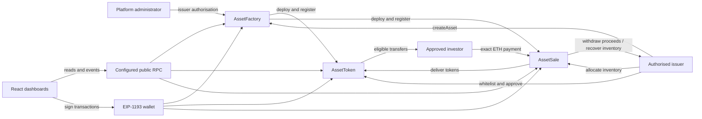

# Final Technical Report

Tokenisation of Real-World and Digital Assets on Ethereum — NTU SC4053, AY2026–2027 Semester 1. Reviewed 6 November 2026 (Asia/Singapore), starting revision `0b1249e`. The Codex session made no commits, by instruction; the work was committed afterwards as `c7cb0d1`.

## Problem and scope

The project demonstrates programmable issuance, settlement and transfer permissions for fictional property and digital-licensing units. Fragmented ownership records and manual eligibility checks motivate a shared on-chain register. The system records ERC-20 balances and transaction events; it does not verify custody, perform real KYC, or establish enforceable legal ownership. Prices and assets are simulated. No institutional integrations, redemption, yield, price oracle, NFTs or upgradeable contracts are implemented.

The initial proposal is preserved in [spec-v0](spec/spec-v0.md). [Spec-v1](spec/spec-v1.md), later phase requirements and decisions D1–D18 specify the implemented behavior. Later explicit requirements supersede historical API names and revocation rules.

## Architecture

The factory creates an independent token and sale for each asset in one transaction. Neither the factory nor platform admin receives token administration by deployment. Token and sale issuer addresses refer to the authorised creator. No proxies or shared asset balances exist.

## Contract design and interface

| Contract | State / inheritance | Public operations and restrictions |
|---|---|---|
| AssetFactory | Immutable admin, authorisedIssuers, tokenToSale, private asset array; no inheritance | Admin calls authorizeIssuer/revokeIssuer. Authorised issuer calls createAsset. Anyone reads getAsset/getAssetCount and public getters. |
| AssetToken | ERC20, AccessControl, Pausable; immutable issuer, whitelist mapping, COMPLIANCE_ROLE | ERC-20 transfer/transferFrom/approve and getters; setWhitelisted requires compliance role; pause/unpause/forcedTransfer require default admin; inherited grantRole/revokeRole/renounceRole govern delegation. |
| AssetSale | SafeERC20 library; immutable assetToken, issuer and pricePerToken; unclaimedProceeds, saleClosed | Issuer calls allocate, withdrawProceeds, sweepExcessETH, closeSale, recoverUnsoldTokens. Eligible buyers call payable buyTokens. Anyone reads availableTokens and public getters. |

The full ABI-derived function inventory, including inherited functions and mutability, is [contract-inventory.json](audit/contract-inventory.json).

AssetToken has zero decimals and mints a positive fixed supply only in its constructor. The designated issuer is initially whitelisted and receives default admin and compliance roles. `_update` enforces sender and recipient eligibility and pause state for direct/delegated movements, including zero-value transfers. Spender eligibility is intentionally irrelevant: allowance and holder/recipient eligibility are required. Revocation preserves balances and allowances but blocks movement.

D5 recovery is an explicit exception: default admin can force-transfer from a nonzero revoked holder to an eligible recipient even while paused. It cannot mint or burn. D6 prevents removing the issuer's default admin role, while compliance authority remains delegable and revocable. An issuer can therefore restore compliance authority, but loss of the issuer's private key remains an operational risk. Delegated administrators share the issuer's powerful trust boundary.

AssetFactory rejects zero admin/issuer, self-authorisation of the admin, unauthorised creation and nonpositive supply/price; the enum decoder rejects unsupported asset types. Asset IDs are sequential. Metadata and token/sale addresses are recorded atomically. Empty strings are permitted on chain; the frontend requires a name and symbol. Issuer revocation blocks future creation only. It cannot freeze existing assets. Preventing self-authorisation is a policy check, not protection against a second wallet.

AssetSale requires positive quantity, an open sale, eligible buyer, sufficient inventory and exactly quantity × price in wei. Solidity checked arithmetic rejects overflow. Proceeds are recorded before token delivery; a failed transfer reverts token/ETH/accounting changes together. Allocation requires issuer allowance and both issuer/sale eligibility. The factory uses known AssetToken code; separately deployed sales pointing at arbitrary ERC-20 implementations are unsupported.

Withdrawal uses checks-effects-interactions: owed proceeds are zeroed before the ETH callback, and rejected payouts revert the accounting. There is no ReentrancyGuard. Sweep pays only forced ETH above owed proceeds. Closure is irreversible and blocks further purchases/deposits. Unsold recovery requires closure and still follows token pause/eligibility rules. Restoring issuer/sale eligibility and unpausing enables ordinary recovery; privileged D5 recovery remains explicit.

## Frontend and transactions

React routes implement marketplace, asset details/purchase, administration, issuer management and investor portfolio/history. ethers public reads use a configured JsonRpcProvider; wallet writes use BrowserProvider. EIP-1193 events invalidate account/network-dependent roles, balances and forms, and listeners are removed on cleanup. Public registry refreshes retain data to preserve the approval/deposit form; account state is never retained across sessions.

All quantities, prices and payments use BigInt with uint256 bounds; ETH input supports at most 18 decimal places. UI address validation rejects zero/invalid addresses. Compiled artifacts supply ABIs. Displayed portfolio balances come from balanceOf, while history comes from contract-scoped event logs. Purchase and forced-transfer companion Transfer events are deduplicated. Metadata is rendered as text, not injected HTML.

Transaction state distinguishes wallet approval, submitted hash, pending receipt, confirmed receipt, revert, rejection and unknown confirmation. A receipt timeout retains the hash and disables repeated submission in the active session. Rechecking a real receipt determines success or failure. This state is not durable across page reloads. A malicious provider or a state change after preflight cannot be eliminated by UI checks.

Phase 6 fixed AUD-030/SEC-013: signer acquisition now validates factory runtime and deployment block fingerprints through the wallet RPC as well as the public RPC, then rechecks chain/account. Equal chain IDs alone do not identify the same local deployment. The sidebar now names the configured network instead of hardcoding a previous phase.

## Validation and security results

Fresh baseline: 142 contract/script tests, 118 frontend tests and one local service-integration test passed. Final: 153 contract/script tests, including 11 new adversarial tests; 122 frontend tests, including four signing-deployment regressions; one expanded real-chain service lifecycle. Typechecks and frontend build pass. Two errors in newly generated audit helpers were corrected and their initial failure logs retained.

Security tests cover access escalation, direct/delegated compliance, payment boundaries/overflow, insufficient ETH, rollback, two-issuer isolation, revocation recovery, pause and forced transfer. Three deterministic seeds each perform 48 modeled operations. Contract issuer callbacks test repeated withdrawals, cross-function sweeps and rejected payouts. These finite checks are not a mathematical proof.

Native coverage reports 100% production contract lines/statements; including test helpers, 99.25% lines and 99.37% statements. Slither scanned 22 contracts with 102 detectors and produced 29 findings, all individually triaged. No new exploitable production-contract issue was confirmed. Root npm audit reports 16 affected development dependency nodes; frontend and root production-only audits report zero. Compiler 0.8.24 has newer advisories whose applicability is discussed, not silently dismissed. See [test results](audit/test-results.md), [findings](audit/security-findings.md), [static analysis](audit/slither-summary.md), [dependency review](audit/dependency-review.md) and [coverage/gas](audit/coverage-summary.md).

The exact Phase 6 demonstration executes 31 checks and 18 mined transactions, including three expected reverts. Final CPT balances: issuer 9850, A 80, B 70, sale 0; total supply 10000. The issuer receives 0.15 ETH proceeds, and a separate 5000-unit DLT asset remains isolated. [Receipt/state evidence](audit/final-demo.json) includes addresses, hashes, logs, fees and reverted transactions. This is local evidence, not public-explorer evidence.

## Deployment and reproducibility

Solidity 0.8.24 with optimizer runs=200 targets Shanghai in both default and production profiles. Hardhat 3.21.0, OpenZeppelin 5.6.1 and ethers 6.17.0 are resolved by lockfiles. Runtime sizes: factory 13545, token 4124, sale 3132 bytes. No production Solidity or dependency version changed in Phase 6; no new gas savings are claimed.

Local deployments use chain 31337. Deploy scripts write the factory address, chain, deployment block/hash, runtime hash and ABIs; local records change after each reset. The Sepolia configuration uses chain 11155111 and named config variables/keystore entries, but no verified Sepolia deployment record is present. See the [deployment guide](Deployment_Guide.md).

## Remaining limitations and future work

Required Sepolia evidence remains outstanding. AUD-002's manual MetaMask rehearsal was accepted on 7 November 2026 for 0b1249e (user-reported, commit 7c73461, screenshots pending); it predates the Phase 6 signing change, which has not been checked in MetaMask. Browser connection discovery returned no available browser, so no screenshots or browser acceptance are claimed. The assignment PDF was absent; the team must check course packaging and complete identity/contribution fields in the AI report.

Production use would require independent review, resolution of compiler/dependency concerns, key governance/recovery design, verified legal/custody arrangements and stronger operational monitoring. Registry/history pagination, durable pending-transaction tracking and explicit UI pause status are possible future refinements. They are not implemented features. The present system is an academic local demonstration, not a production investment platform.
