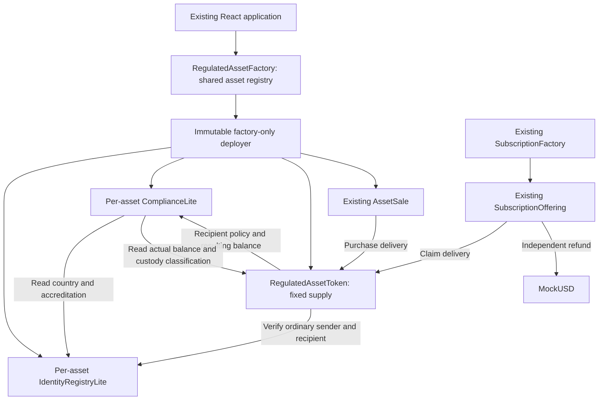

# Compliance engine and regulated issuance

Authority: [specification B–F](erc3643-lite-specification.md). Legacy `AssetToken` and deployed assets retain their existing whitelist/forced-transfer behavior. New `RegulatedAssetToken` has no forced-transfer or arbitrary recovery API.

## Deployment and authority

`RegulatedAssetFactory` inherits AssetFactory and supports both `createAsset` and `createRegulatedAsset(RegulatedRequest)`. Only `_registerAsset` was extracted from the old factory to share registry insertion; IDs, legacy creation arguments, authorization and sale registry metadata remain compatible. Regulated metadata is exposed through `modules(assetId)`; legacy IDs have zero module addresses.

The factory creates an immutable `RegulatedAssetDeployer` in its constructor. Only that factory can call the helper. Each regulated creation atomically deploys an identity registry, compliance policy, token and exact direct sale, binds the policy once, and authorizes that sale before publishing the asset ID. No external transaction can intercept an initialization window. Deployment roles go to the designated platform administrator or issuer, never the helper. Constructor-only minting uses OpenZeppelin ERC20 accounting directly; all subsequent movement passes through `_update`.

The compliance constructor fixes its registry, binder and policy administrator. Only the binder can set its token once. The issuer can change policies but cannot replace validation contracts. The token's registry, policy and factory references are immutable. The helper's binding permissions are consumed; it has no function to invoke administrative operations afterward.

The factory administrator selects a SubscriptionFactory once. Its `assetFactory()` must match; this is a **trusted deployment choice**, not bytecode proof that an arbitrary administrator-supplied contract is honest. The local deployment script selects the audited implementation. The token's issuer may register only an offering listed by that selected registry with matching token and issuer. A forged sale, standalone offering or EOA cannot obtain custody exemption. The subscription contracts themselves are unchanged.

## Policy and execution

| Check | Ordinary sender | Ordinary recipient | Operational issuer/sale/subscription |
|---|---|---|---|
| Valid synthetic identity | Required | Required | Exempt |
| Allowed country | Not checked on outgoing side | Required | Exempt |
| Accreditation | Not checked on outgoing side | Required when enabled | Exempt |
| Maximum resulting holdings | No outgoing cap | Required for positive incoming movement | Exempt |
| Sufficient balance / ERC20 allowance | Required as applicable | — | Required as applicable |
| Fixed supply / custody accounting | Preserved | Preserved | Preserved |

Country allowlists start empty. `setCountryAllowed`, `setMaxWalletHolding` and `setAccreditationRequired` are issuer-only and independent per asset. A maximum of zero permits no positive incoming investor movement. Lowering a cap does not confiscate balances or prevent an otherwise valid holder from sending out. Self and zero transfers do not increase holdings and bypass only the capacity calculation; identity and recipient policy remain mandatory. For distinct endpoints, capacity uses `balance <= maximum && amount <= maximum - balance`, avoiding addition overflow.

Issuer, exact sale and approved subscription escrow classifications are permanent. There is **no removal API**: an administrator cannot revoke custody while claims remain outstanding. There is also no generic classification grant, confiscation, token mint/burn or freeze. Permanent enrollment trades operational revocation flexibility for protection against accidental escrow lockout. Existing sale close/recovery and offering reserves constrain the actual contracts. `paused()` always returns false for compatibility; pause is not implemented on regulated tokens.

`transferStatus(from,to,amount)` is the enforcement source for `_update`, and `canTransfer` returns whether that code is zero. Codes are 0 allowed, 1 sender identity invalid, 2 recipient identity invalid, 3 recipient country restricted, 4 accreditation required, 5 cap exceeded, 7 insufficient balance, 8 zero endpoint. No code 6 is claimed because pause/freeze are absent. ERC20 may report zero-address/allowance errors before reaching `_update`. A preflight does not inspect a particular spender allowance or guarantee a later transaction.

The compatibility getter `isWhitelisted` means *current recipient identity and country/accreditation eligibility*, without wallet capacity. It is not writable. The sender policy intentionally requires valid identity even though the reference standard chiefly checks recipient identity. Outgoing country/accreditation restrictions are not added. The frontend preflights transfers using the token and supports outgoing transfers even when a holder's country/accreditation no longer qualifies for receiving.

All validator calls are `view` calls (EVM static calls), with fixed known code and constant-size reads. No user callbacks, holder enumeration or policy replacement is exposed. Failure reverts balances, allowance expenditure, sale ETH accounting and events atomically.

## Subscription implications

Commitments use the compatibility eligibility getter: current identity, jurisdiction and accreditation, without promising future wallet capacity. The original pro-rata allocation and conservative soft-cap mathematics are unchanged. Claims enforce current identity and capacity. A 450-token allocation with an existing 200 balance and a 500 cap remains fully reserved while delivery is blocked. The investor can restore credentials, move eligible holdings out, or await a policy update; allocations are not reduced or expired. If identity is invalid, outgoing transfers are also blocked until renewal. Refunds and accounting-only settlement remain available throughout. Issuers cannot recover reserved allocation inventory.

## Existing frontend workflow

- `/issuer`: regulated mode is the default when the configured factory supports it. Choose supply, cap and accreditation. Investor country access starts closed.
- `/compliance?asset=0`: platform admin manages attestors; trusted attestor registers/renews credentials; issuer configures asset policy. Roles and attributes come from chain reads.
- `/compliance`: connected investor status, arbitrary identity lookup and explicit sender/recipient/quantity preflight. Results refresh every 15 seconds and after receipts; account changes clear forms/results.
- Existing sale inventory controls work without manual sale whitelisting for regulated assets. Legacy whitelist controls are replaced with a link to Compliance.
- Subscription creation remains in the issuer dashboard. Authorize the exact offering's custody, approve inventory, deposit, then use the original commit/settle/refund/claim flow.
- Purchases, transfers and claims call the real preflight and show decoded reasons. A successful read remains subject to on-chain rechecking. Refund paths do not call compliance.

Both public and signing RPC deployment fingerprints are checked for regulated writes. Existing transaction status handles pending, confirmation, rejection and uncertain receipts. Policy status remains public without connecting a wallet; write controls require the corresponding on-chain role and the correct network.
