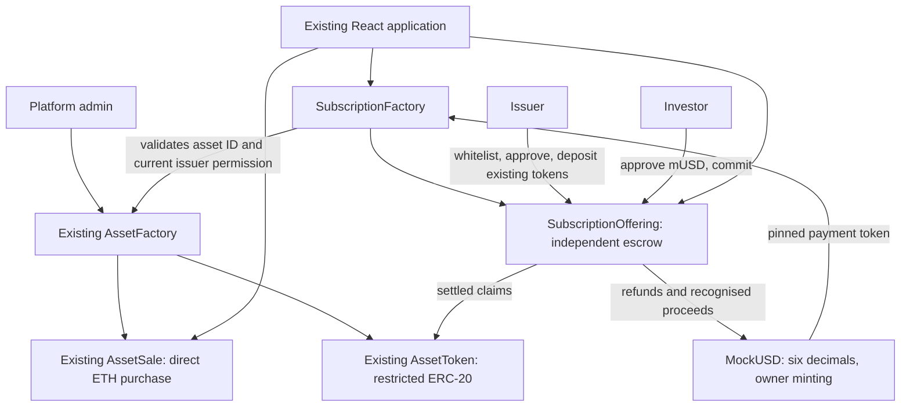
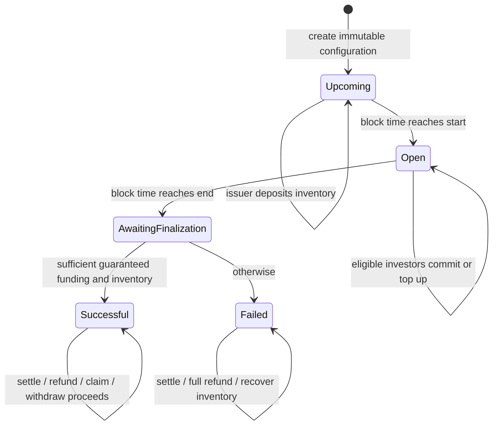

# Subscription offering architecture and operation

Implemented 7 November 2026. Authority: [requirements](spec/subscription-requirements.md) and [decisions](subscription-offering-specification.md).

## Additive architecture



AssetFactory, AssetToken and AssetSale source files are unchanged. Asset IDs, direct-sale addresses, APIs and permissions remain compatible. SubscriptionFactory stores offering addresses and their original asset IDs; it checks both current issuer authorisation and asset ownership. A separate factory avoids increasing AssetFactory's embedded deployment code and does not require redeploying existing assets.

The platform deployment pins an actual MockUSD instance. Standalone offerings accepting arbitrary tokens are outside the supported application trust boundary. Constructor metadata validation and transfer-delta checks do not prove an arbitrary ERC-20 is honest.

Multiple offerings can reference an asset, but each must receive real tokens from the issuer's existing balance. Tokens already in a direct sale or another subscription escrow cannot fund a second offering. Supply is never increased by an offering.

## Lifecycle



Time stages are computed on chain. Commits use the half-open interval `[start,end)`. No server is required to close subscriptions. Anyone can finalise once after end. There are no cancellation, price mutation, arbitrary claim expiry or upgrade functions.

## Public operations

| Contract/function | Caller | Behaviour |
|---|---|---|
| MockUSD.mint(to, amount) | Owner | Distributes simulated six-decimal currency; no public faucet |
| SubscriptionFactory.createOffering(assetId, supply, price, softCap, start, end) | Current authorised asset issuer | Deploys independent escrow, computes hard cap and records association |
| offeringCount / offeringAt / assetIdOf / isOffering | Anyone | Registry reads; frontend pages the list |
| depositOfferingTokens(amount) | Issuer | Before start, approve and transfer inventory; cumulative deposit ≤ offered supply |
| commit(amount) | Eligible investor | Within window, fully funded escrow, exact price multiple; transfer mUSD and accumulate commitment |
| state() | Anyone | Upcoming/Open/AwaitingFinalization/Successful/Failed enum |
| finalizeOffering() | Anyone | After end, fixes outcome and guarantee; O(1) |
| allocationOf(investor) | Anyone | After finalisation, immutable allocation, accepted amount and original refund entitlement |
| settleSubscription() | Subscriber | Records own entitlement, refund credit and recognised proceeds; no transfers |
| settleFor(investor) | Anyone | Same accounting for the named subscriber; cannot redirect payouts |
| withdrawRefund() | Settled subscriber | Pays only caller's outstanding mUSD credit; independent of asset eligibility |
| claimTokens() | Settled investor | Successful offering, positive unclaimed allocation; AssetToken enforces eligibility/pause |
| withdrawProceeds() | Issuer | Pays recognised, unwithdrawn proceeds only |
| paymentLiabilities / reservedTokens / recoverableTokens | Anyone | Explicit solvency and inventory-reserve views |
| recoverUnsoldTokens() | Issuer | After finalisation, transfers only inventory above outstanding claim reserves |
| commitments / entitlements and aggregate getters | Anyone | Auditable demand, settlement, refunds, claims and proceeds |

Events: OfferingCreated, InventoryDeposited, SubscriptionCommitted, OfferingFinalized, AllocationSettled, RefundWithdrawn, TokensClaimed, ProceedsWithdrawn and InventoryRecovered. Approval events are permissions, not investments.

## Frontend

- Marketplace shows subscription cards separately from direct ETH sales. `/subscriptions` pages offerings; `/offerings/:address` presents their lifecycle and investor actions.
- Existing issuer dashboard adds creation for the selected asset. The offering page provides eligibility approval, inventory allowance and deposit as separate transactions.
- Investor approval and mUSD commitment are separate transactions. Inputs persist across receipt refreshes and reset on wallet session changes.
- Allocation, accepted payment, refundable credit and claimed status are independent fields. Refund remains usable when token eligibility/pause blocks claiming.
- Demand graphics scale beyond the hard cap and display the true percentage. Status comes from the contract, not a comparison between demand and soft cap.
- Existing wallet/account/network and transaction status components handle signing, rejection, hashes, receipt confirmation and uncertain receipts. Subscription writes additionally validate code fingerprints and registry links through both public and wallet RPCs.
- History reads actual offering/registry events in 2,000-block pages, adaptively splits provider range-limit errors, and labels mUSD separately from ETH. It does not count approval as a commitment or refund as a purchase.

## Run locally

Use Node and dependencies described in README; no new packages are required.

```bash
npm ci
npm ci --prefix frontend
npm run compile
npm run node                         # keep running in terminal 1
```

In terminal 2:

```bash
npm run deploy:local                 # new main factory for a new local session
npm run deploy:subscriptions:local   # reuse configured asset factory; add mUSD and registry
npm run dev --prefix frontend
```

The extension script refuses mismatched/stale deployments, requires the platform admin as its first signer, and refuses to replace an already configured live subscription registry. It mints 10,000 mUSD to local accounts 2–5. Account 0 is platform admin/currency owner; account 1 is issuer; accounts 2–4 are the three investors; account 5 is initially unapproved. Whitelisting remains an explicit issuer action. Deployment writes addresses, code hashes, block context and ABI records; no secrets are read or written.

For an existing valid configured local AssetFactory, run only `deploy:subscriptions:local` to add the extension. Running `deploy:local` creates a new empty registry and updates frontend configuration; do that only for a new demo session. The extension setup intentionally supports only local chain 31337. Existing Sepolia direct-sale tooling remains unchanged; public subscription deployment is not claimed.

In the UI, authorise the issuer, create CPT (10,000 units), create a 1,000-unit subscription at 2 mUSD with a 1,200 mUSD soft cap and future dates, then whitelist and fund the offering before start. Whitelist the three investors through the existing issuer eligibility controls. They approve and commit 1,800/1,400/800 mUSD. After end, finalise, settle, refund and claim; issuer withdraws recognised proceeds. Supply and direct-sale inventory are independent.

The fully automatic scenario is separate and ephemeral:

```bash
npm run demo:subscriptions
```

It advances local time, runs successful and failed offerings and exits nonzero on assertion failure. Its deployments disappear after execution; its JSON is evidence, not frontend configuration. After manually advancing a persistent local chain's time, schedule subsequent offerings later than that chain's current timestamp.

## Manual acceptance still required

No browser was connected during this implementation. Validate real MetaMask discovery/signing/account switching, narrow and desktop layouts, time-boundary transitions and complete flows visually. Automated component and EIP-1193 integration tests are not browser-extension evidence. No screenshots, public-network transaction or hosted deployment is claimed. No presentation deck was present; any future slides should distinguish instant ETH sales from windowed mUSD subscription/settlement.
